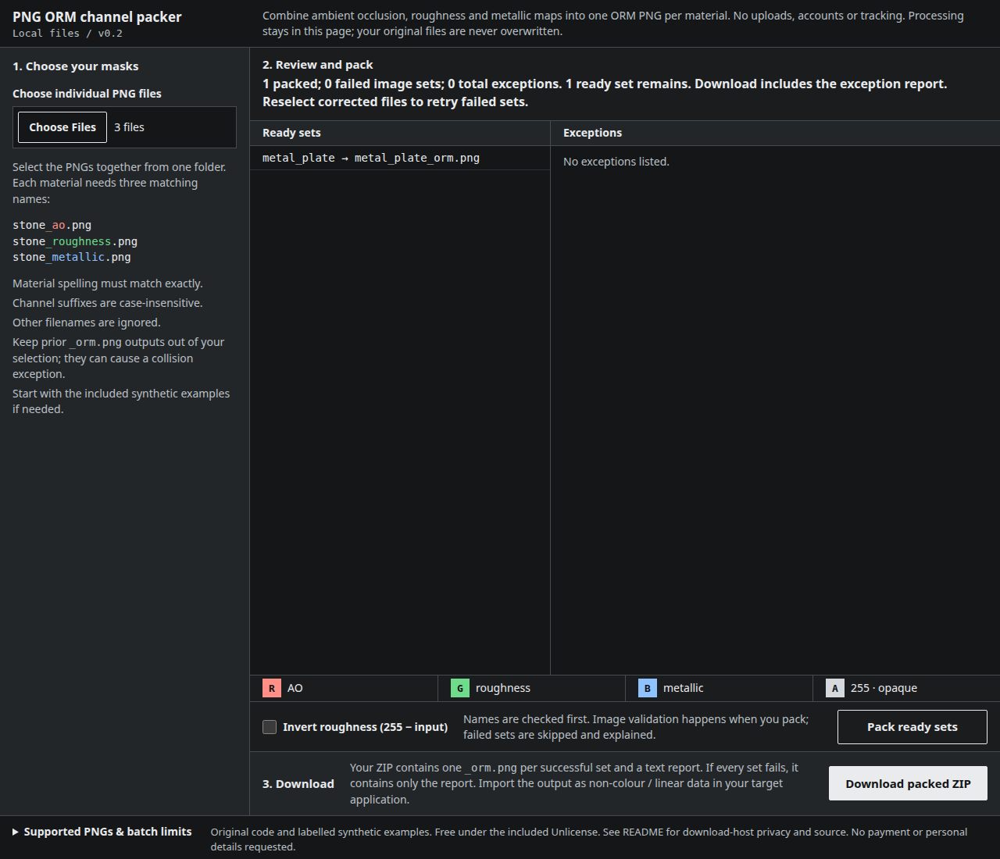

# PNG ORM channel packer · v0.2

Batch ambient occlusion, roughness and metallic masks into exact numeric ORM PNGs. Open one HTML file locally; no installation, upload, account or tracking.



## Three-step quick start

1. **Open and select.** Extract this ZIP, open `texture-batch.html` in desktop Chrome or Firefox, then choose the individual PNGs together from one folder. Try all six labelled synthetic files in `examples/` first. For your own material, use matching names such as `stone_ao.png`, `stone_roughness.png`, `stone_metallic.png`.
2. **Review and pack.** Check the listed output names and exceptions, choose roughness inversion only if required, then click **Pack ready sets**. Names are checked before processing; image validation happens during packing. Failed sets leave **Ready sets**; successful sets stay available. Changing inversion does not retry failed sets. Correct the inputs and select the files again to retry them.
3. **Download.** Click **Download packed ZIP**. Each successful set produces an `_orm.png`. The included text report explains skipped/failed sets. If all sets fail, the ZIP contains only the report. The six synthetic examples produce two images and no exceptions.

Material stems must match exactly; channel suffixes are case-insensitive. Other filenames are ignored. Rename library-specific suffixes yourself; no automatic map-name conversion or folder selection is included.

## Exact mapping

| Output | Input value |
| --- | --- |
| Red | AO red-channel byte |
| Green | Roughness red-channel byte, or `255 − byte` when inversion is selected |
| Blue | Metallic red-channel byte |
| Alpha | 255 |

Input alpha is ignored, including fully transparent pixels. No canvas, colour correction, resizing or source metadata is used. Originals are read, never overwritten. Treat the output as non-colour / linear data in your target application. This tool packs data; it does not configure a shader or verify an engine import.

Using Godot 4.7? See the [ORM material setup guide](docs/godot-orm.md), with a copyable material resource and the import settings that affect channel data.

## Format and batch limits

- **PNG only:** 8-bit, non-interlaced grayscale, RGB, grayscale-alpha or RGBA. All three masks in each set must have the same dimensions. Palette PNGs, 16-bit PNGs, animated PNGs and other formats are rejected, not converted.
- **Per image:** up to 4096 × 4096 and 32 MiB compressed input. Encoded PNGs also have a 32 MiB limit: noisy large images can fail below the dimension limit.
- **Per selection:** up to 500 files and 256 MiB compressed input total. Output payload up to 120 MiB; final ZIP up to 128 MiB including metadata. Sets are processed sequentially. Reduce batch size if memory is limited; these caps are not a memory guarantee.
- **Browser:** native `CompressionStream` and `DecompressionStream` required. Exercised on Linux with Google Chrome for Testing 145.0.7632.6 and real Gecko Firefox 157.0 (Playwright distribution), using the file chooser/file-input boundary and saved downloads. Safari, mobile platforms, other operating systems and native OS-dialog behaviour are outside this test scope.
- **Naming:** ambiguous/case-colliding names and unsafe ZIP paths are skipped. No missing map is fabricated. Existing `_orm.png` files selected alongside sources can cause a collision exception; keep prior outputs out of your input selection.

## Files and source

`texture-batch.html` is the complete offline tool. `src/` contains the original PNG, grouping/ZIP and page code. `examples/` contains six small, deterministic synthetic maps, not customer files. `screenshot.png` is an actual browser capture, not a mockup. The screenshot uses a separately tested CC0 Poly Haven Metal Plate material, explicitly prepared as 8-bit PNG because its original 16-bit PNGs are outside the supported format. Third-party material maps are not included in this download.

To rebuild the standalone page with Python 3 (standard library only):

```python
from pathlib import Path
page = Path('src/page.html').read_text()
for marker, name in [('/* PNG_MODULE */', 'src/png.cjs'), ('/* BATCH_MODULE */', 'src/batch.cjs')]:
    page = page.replace(marker, Path(name).read_text())
Path('texture-batch.html').write_text(page)
```

Original code and synthetic examples are provided under the included Unlicense, without warranty. No exclusive authorship or third-party rights clearance is claimed. Poly Haven material: https://polyhaven.com/a/metal_plate, CC0: https://polyhaven.com/license.

## Privacy

The extracted tool has no upload endpoint, analytics, external script/font, activation check or remote workspace. Its content security policy blocks network connections. It does not request email, payment, feedback or personal details. Selected files remain in the browser's memory until the page is closed or replaced; source files are not modified.

GitHub, if used to distribute the download, processes request/device data under its [Privacy Statement](https://docs.github.com/en/site-policy/privacy-policies/github-general-privacy-statement). Download hosting is separate from local processing. Aggregate download counts are not proof of unique people, successful use or demand. No additional tracking is included.
